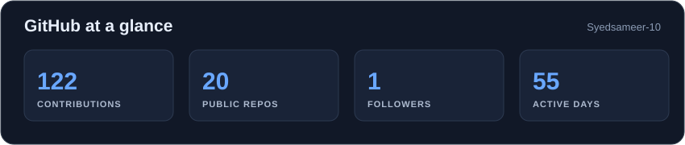
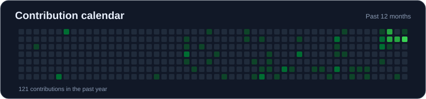

<!-- HEADER -->
<p align="center">
  
</p>

<p align="center">
  
</p>

<p align="center">
  <a href="https://www.linkedin.com/in/syedsameer1102/"></a>
  <a href="mailto:sameerahamed7616@gmail.com"></a>
  <a href="https://github.com/Syedsameer-10"></a>
</p>

<p align="center">
  
  
</p>

---

## 👋 About

```yaml
role:    ML · AI Agents · Full-Stack
base:    Chennai, India · College of Engineering, Guindy · B.Tech IT '28
builds:  browser-based tools · full-stack web apps · data workflows
focus:   learning ML, DL, and open source · building useful products
```

I build web applications from interface to database while learning ML, deep learning, and AI agents. I like turning practical problems into simple, working products and improving them through feedback.

---

## 🚀 Featured Builds

| Project | What it does |
|---|---|
| [**Run My Code**](https://runmy-code.vercel.app/) | Online code editor with custom input, execution output, error reporting, and browser file access. Uses Monaco Editor, Judge0, and Docker. |
| [**Tomato**](https://tomato-eats.vercel.app/) | Food ordering platform with restaurant browsing, menu search, cart, checkout, customer and admin roles, and image management. Uses React, Express.js, PostgreSQL, and Supabase. |

---

## 🛠️ Tech Stack

| | |
|---|---|
| **Languages** |  · SQL |
| **Frontend** |  · Monaco Editor |
| **Backend & Data** |  |
| **Tools** |  · Render · Cloudinary |

*Currently building foundational skills in Python and Java.*

---

## 📊 Stats

<p align="center">
  
</p>

### 🟩 Contribution Graph

<p align="center">
  
</p>

---

## 🔭 What's Next

- Build useful software with thoughtful interfaces and dependable backend systems.
- Grow through engineering internships, collaboration, and hackathons.

---

<p align="center">
  <b>💼 Open to software engineering internships and collaboration.</b><br />
  <a href="mailto:sameerahamed7616@gmail.com">sameerahamed7616@gmail.com</a>
</p>

<p align="center">
  
</p>
